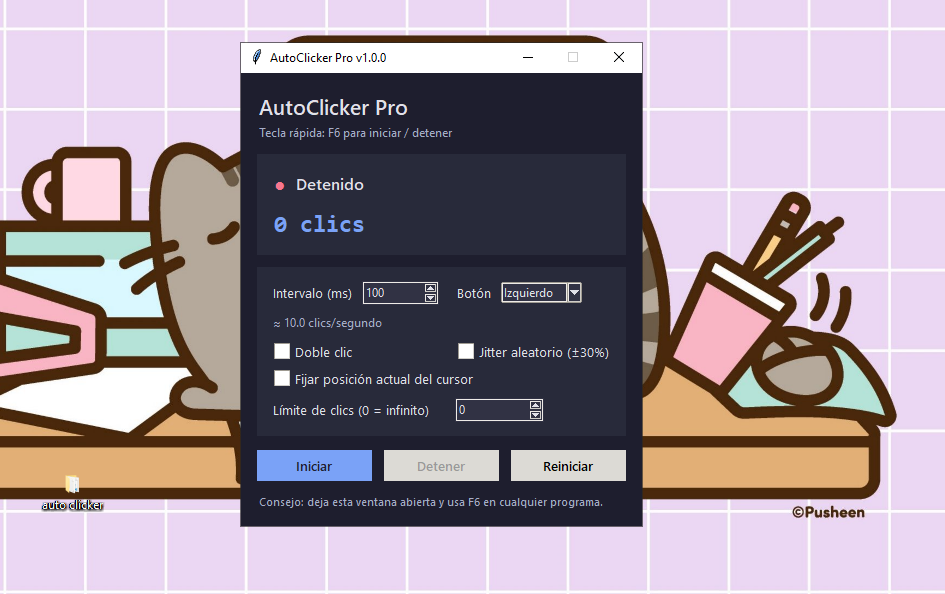

# 🖱️ Auto Clicker

  
  

  

  <b>Automatización de clics. Simplicidad. Tecnología.</b>
   
  Una herramienta creada para explorar nuevas posibilidades de automatización.

  <a href="https://github.com/xAlan007x/auto-clicker">📂 Repositorio</a>
  •
  <a href="https://github.com/xAlan007x">👨‍💻 Desarrollador</a>

---

## ✨ ¿Qué es Auto Clicker?

**Auto Clicker** es un proyecto de software enfocado en la automatización de clics del mouse.

Su propósito es simplificar tareas repetitivas mediante una herramienta digital práctica, con una experiencia sencilla y orientada a la productividad.

---

## 🚀 Características del proyecto

- 🖱️ **Automatización:** simplifica acciones repetitivas.
- ⚡ **Practicidad:** busca reducir las tareas manuales.
- 🎯 **Precisión:** un proyecto enfocado en el control de las acciones.
- 💻 **Desarrollo:** creado como parte de un proyecto de programación.

---

## 🖼️ Vista del proyecto

  

---

## 🛠️ Tecnologías

Las tecnologías y herramientas utilizadas pueden consultarse en los archivos del repositorio.

---

## 📦 Instalación y uso

1. Entrá al repositorio.
2. Revisá los archivos disponibles.
3. Seguí las instrucciones correspondientes al código del proyecto.

🔗 **[Abrir repositorio en GitHub](https://github.com/xAlan007x/auto-clicker)**

---

## 🎯 Objetivo

Crear una herramienta útil para automatizar acciones repetitivas y seguir desarrollando soluciones prácticas mediante la programación.

---

## 👨‍💻 Desarrollador

  

Proyecto desarrollado por **xAlan007x**, como parte de su camino en el mundo de la programación.

---

## 💡 ¿Te gusta el proyecto?

Si te interesa el desarrollo, visitá el repositorio y explorá el código.

  ⭐ <b>Explorá. Programá. Automatizá.</b>
   
  Auto Clicker · Un proyecto de xAlan007x

---

  © xAlan007x · Auto Clicker

